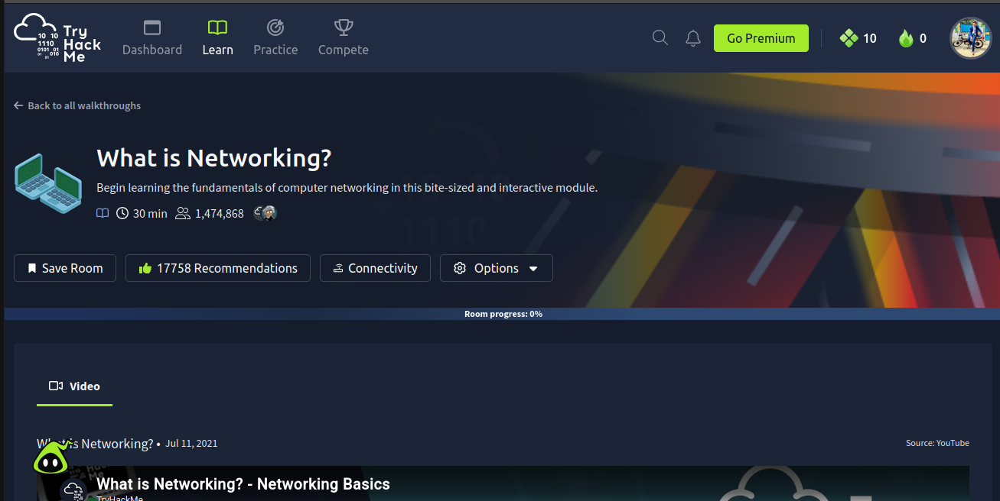
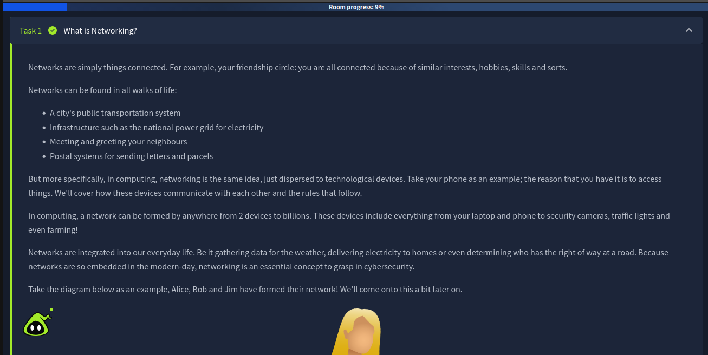
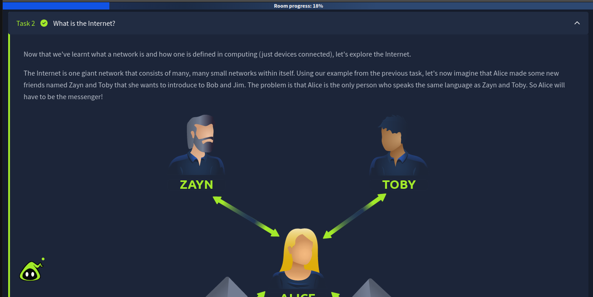
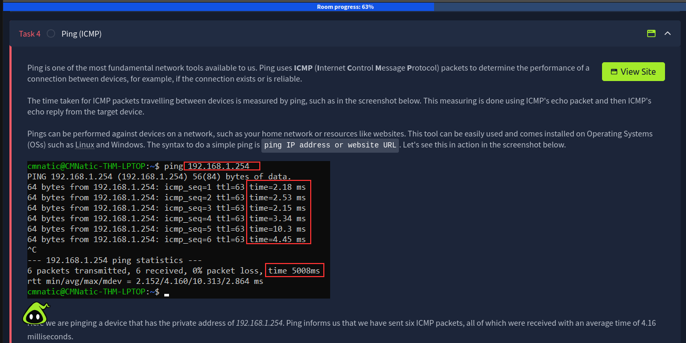

# TryHackMe — What is Networking?

## Lab Information

- **Platform:** TryHackMe
- **Room:** What is Networking?
- **Category:** Networking Fundamentals
- **Date:** 10 November 2026
- **Status:** In Progress completed
- **Room Link:** https://tryhackme.com/room/whatisnetworking

## Learning Objectives

- Understand what a computer network is.
- Learn how the Internet connects networks.
- Understand IP addresses and MAC addresses.
- Learn about ICMP and the ping command.
- Practice basic network connectivity testing.

---

## Task 1 — What is Networking?

### What I Learned

A computer network is a collection of two or
more connected devices that can communicate
and share information.

Networks are used in everyday life to connect
computers, smartphones, servers, and other devices.

### Real-World Example

My laptop and smartphone can connect to the
same Wi-Fi router and become part of a local network.

### Key Takeaways

- A network connects multiple devices.
- Devices communicate and share information.
- Networks can be small or large.
- Networking is an important foundation of cybersecurity.

---

## Task 2 — What is the Internet?

### What I Learned

The Internet is a global network that connects
many smaller computer networks.

It allows devices around the world to communicate,
exchange and share information.

### Types of Networks

**1. Private Network**

A private network is a network with restricted
access, commonly used in homes, schools,
and businesses.

Example:
My laptop and smartphone connected to
my home Wi-Fi network.

**2. Public Network**

A public network is a network that is accessible
to the general public, subject to its access rules.

Example:
The Internet is a global public network.

### Real-World Example

When I open TryHackMe using Firefox,
my laptop connects through my local network
and Internet service provider to access
TryHackMe's servers.

### Key Takeaways

- The Internet connects many smaller networks.
- Private networks restrict access to authorized users.
- Public networks provide broader connectivity.
- The Internet enables communication worldwide.

---

## Task 3 — Identifying Devices on a Network

### What I Learned

Devices connected to a network need to be
identified so they can communicate.

Two types of addresses are used to identify Devices. 
IP addresses and MAC addresses.

### 1. IP Address

An IP (Internet Protocol) address is a logical
address used to identify a network interface
and deliver data across IP networks.

Example:

192.168.1.10

IP addresses help devices send and receive
information across networks.

### 2. IPv4 Address

IPv4 stands for Internet Protocol Version 4.

An IPv4 address contains 32 bits, commonly
represented as four decimal numbers separated
by dots.

Example:

192.168.1.10

Each number represents 8 bits (one octet)
and ranges from 0 to 255.

### 3. IPv6 Address

IPv6 stands for Internet Protocol Version 6.

An IPv6 address contains 128 bits, commonly
represented as eight groups of hexadecimal
numbers separated by colons.

Example:

2001:0db8:85a3:0000:0000:8a2e:0370:7334

Each group contains 16 bits and consists
of up to four hexadecimal digits (0–9 and A–F).

IPv6 was developed to overcome IPv4 address
limitations and provide a much larger
address space.

### Key Features of IPv6

- Uses 128-bit addresses.
- Contains eight groups of hexadecimal digits.
- Groups are separated by colons (:).
- Supports approximately 340 undecillion addresses.
- Provides a much larger address space than IPv4.
- Supports automatic address configuration.

### IPv4 vs IPv6

| Feature | IPv4 | IPv6 |
|---------|------|------|
| Full Name | Internet Protocol Version 4 | Internet Protocol Version 6 |
| Address Size | 32 bits | 128 bits |
| Address Format | Decimal | Hexadecimal |
| Structure | 4 octets | 8 groups |
| Separator | Dot (.) | Colon (:) |
| Example | 192.168.1.10 | 2001:db8::1 |
| Address Space | Approximately 4.3 billion | Approximately 340 undecillion |

### 4. MAC Address

MAC stands for Media Access Control.

A MAC address is a data link-layer address
associated with a network interface.

Example:

00:1A:2B:3C:4D:5E

MAC addresses help identify network interfaces
during communication on a local network.

### 5. IP Address vs MAC Address

| IP Address | MAC Address |
|------------|-------------|
| Logical network address | Data Link-layer address |
| Used for IP communication and routing | Used for local network communication |
| Can change depending on network configuration | Often assigned to network hardware, but can be changed or randomized |
| Example: 192.168.1.10 | Example: 00:1A:2B:3C:4D:5E |

### Practical Activity

I completed the TryHackMe interactive
exercise about identifying devices
using IP and MAC addresses.

### Key Takeaways

- IP addresses are used for communication
  across IP networks.
- IPv4 addresses contain 32 bits.
- IPv6 addresses contain 128 bits.
- MAC addresses operate at the data-link layer.
- IP and MAC addresses serve different purposes.

---

## Task 4 — Ping (ICMP)

### What I Learned

Ping is a network diagnostic utility used to
test whether a device responds to network
connectivity requests.

Ping commonly uses ICMP (Internet Control
Message Protocol) Echo Request and Echo Reply
messages.

### What is ICMP?

ICMP stands for Internet Control Message Protocol.

It is used to communicate network errors,
diagnostic information, and operational messages.

### How Ping Works

1. The source device sends an ICMP Echo Request.
2. The destination device receives the request.
3. If permitted, the destination sends an ICMP Echo Reply.
4. The source measures the response time.

### Practical Activity

In the TryHackMe networking room, I practiced
using the ping command to test connectivity
to a network destination.

Command:

`ping -c 4 8.8.8.8`

### Understanding the Command

| Component | Meaning |
|-----------|---------|
| ping | Tests network reach-ability |
| -c 4 | Sends four Echo Requests |
| 8.8.8.8 | Destination IPv4 address |

### Understanding Ping Results

The results of the exercise showed:

- Packets transmitted: 4
- Packets received: 4
- Packet loss: 0%

This indicates that all four requests received
responses during the test.

### Important Networking Concepts

**Latency:**
The time taken for a packet to travel to
the destination and for a response to return.

**Packet Loss:**
The percentage of transmitted packets that
do not receive the expected responses.

**TTL (Time To Live):**
An IP header field that limits how many
router hops a packet can travel.

### Key Takeaways

- Ping is useful for troubleshooting networks.
- ICMP supports network diagnostics.
- Ping can measure round-trip response time.
- Packet loss may indicate connectivity problems.
- A failed ping does not always mean the
  destination is offline because ICMP may be blocked.

---

## Task 5 — Conclusion

### Room Summary

This TryHackMe room introduced me to fundamental
networking concepts and basic connectivity testing.

Throughout the room, I studied how devices connect,
communicate, and exchange information over networks.

### Key Concepts I Learned

1. **Computer Networks**
   - How devices communicate and share resources.

2. **The Internet**
   - How smaller networks connect globally.

3. **IP and MAC Addresses**
   - How network interfaces are identified.
   - The differences between IPv4 and IPv6.

4. **Ping and ICMP**
   - How ICMP supports network diagnostics.
   - How to interpret ping results.

### Practical Skills Developed

- Understanding how devices are identified on networks using IP and MAC addresses.
- Using the ping command in a training environment.
- Interpreting latency and packet loss.
- Understanding basic network troubleshooting.

### Personal Reflection

This room helped me strengthen my understanding
of networking fundamentals.

I now have a better understanding of how network
communication works and why networking knowledge
is important for cybersecurity.

### Next Learning Goal

Study LAN fundamentals, including:

- LAN and WAN differences
- Network topologies
- Switches and routers
- Basic network communication

### Reference

TryHackMe — What is Networking?
https://tryhackme.com/room/whatisnetworking

---

## Practical Evidence — TryHackMe Screenshots

The following screenshots document the learning
materials and exercises I explored while studying
networking fundamentals on TryHackMe.

### Screenshot 1 — Room Overview

This screenshot shows the TryHackMe
"What is Networking?" room.

### Screenshot 2 — Networking Fundamentals

This screenshot shows the introduction
to computer networking.

### Screenshot 3 — Understanding the Internet

This screenshot shows how multiple
networks connect to form the Internet.

### Screenshot 4 — Ping and ICMP

This screenshot shows the educational example
used to explain ping and ICMP in TryHackMe.
